<p align="center"></p>

<p align="center">
  <a href="https://benzo.space"><b>Live on testnet: benzo.space</b></a> ·
  <a href="#check-a-real-round-in-two-minutes"><b>Check a round yourself</b></a> ·
  <a href="#what-this-is-not"><b>What this is not</b></a>
</p>

---

## The problem with asking for bids

Every auction has the same weak spot: the person running it sees the bids first.

- On a normal exchange, an order book is a list of everyone's intentions. Whoever sees it early can trade ahead of it.
- A "sealed" auction is only sealed by a promise. The auctioneer can peek, leak, or let a friend bid last.
- On a public chain it's worse. Every bid is a transaction anyone can read, sorted by price, before the auction closes.

The Zecathon Private Markets track put it in one line: *the price should be public and the participants should not.*

Benzo is our answer. It is a sealed-bid market engine on Zcash where **nobody can read a bid before the opening time**. Not the other bidders, not the chain, and not us, the operator.

## How a round works

<p align="center"></p>

1. **Bid.** Your browser seals your order to a future [drand](https://drand.love) round, R. You pay a fixed shielded deposit, and the sealed order rides in its memo.
2. **Freeze.** Before R, the set of sealed bids is locked and signed. Nothing can be added once anyone could open them.
3. **Open.** drand publishes round R on schedule. That value is the key to every bid, so everyone can open them at the same moment.
4. **Clear.** Public, deterministic rules turn the opened bids into fills, one price and refunds.
5. **Settle.** Deposits sit in a vault that needs 2 of 3 signers to spend. Each signer re-opens the bids, recomputes the result and checks every payment before it signs.
6. **Check.** Anyone can rebuild the whole round from the public record with one file.

Nobody holds the opening key: it doesn't exist until drand's round R. So the seal is maths, not a promise.

## The opening, in one picture

<p align="center"></p>

Before R, every bid is the same size, carries the same deposit and is shielded. Nothing on chain says which bid is high.

After R, the prices become public and the people stay private. That's the trade the track asked for.

## Who can see what

This is what each party can read, not what a screen chooses to show. The site has the same table on every round's page.

| | You | Other bidders | Operator | Each signer | Anyone |
|---|---|---|---|---|---|
| **Until the opening** | | | | | |
| Your price | Yes | No | No | No | No |
| That a sealed bid came in | Yes | Count only | Sealed copy | Sealed copy | Count only |
| Your refund address | Yes | No | No | Yes, to check payouts | No |
| **After the opening** | | | | | |
| Every bid's price | Yes | By bid number | By bid number | By bid number | By bid number |
| Who placed each bid | Your own | No | Network data* | Payout address | No |
| Where each payment went | Your own | No | No | Yes | Amounts only |

- Prices open at the drand round set in the terms. A drand quorum acting together could open them early.
- \* The site you bid through sees your network address and timing. Use Tor or a VPN to hide them.
- Moving the escrowed funds takes two of the three signers. The operator alone can't.

## Six markets, one engine

<p align="center"></p>

Every market uses the same deposit, the same freeze, the same opening and one rules registry ([`clear/registry.ts`](clear/registry.ts)). A new market is a new set of clearing rules, not a new system.

| Market | In one line | Where it ran |
|---|---|---|
| Uniform auction | Many units; every winner pays the same, lowest winning price | Zcash testnet |
| Collection drop | Numbered items; drand decides the order of serials | Zcash testnet |
| Token launch | Holder and public tranches, a minimum raise, or everyone is refunded | Zcash testnet |
| Buyback | A treasury buys back from the cheapest sealed asks | Zcash testnet |
| RFQ | Lowest quote wins; the second lowest sets the price | Zcash testnet |
| Blind OTC | Two sealed limits; if they cross, they trade at the midpoint | Zcash testnet |
| Vickrey | One lot; the winner pays the second price | Offline, with real drand |

## Who holds what

<p align="center"></p>

- **Your browser** seals the order. The price never leaves your machine unsealed.
- **drand** is a public randomness beacon run by independent organisations. Its round R is the only key.
- **The operator** runs the round. It can propose payments, but it can't sign them.
- **Three signers** (alice, bob, carol) each re-open the bids, recompute the result and check every payment against their own scan of the chain. Any two can pay. One alone can't.

## Check a real round in two minutes

You don't have to trust the site. With Node 24 and this repo:

```sh
npm ci && npm run build:verify
shasum -a 256 dist/benzo-verify.mjs     # must match docs/verify-bundle.sha256
node dist/benzo-verify.mjs \
  --signer "$(cat docs/evidence/phase-7/gold/doc-walk/signer)" \
  --dir docs/evidence/phase-7/gold/doc-walk/public
```

That folder is a real testnet round: three sealed bids, opened at a drand round and settled by 2 of 3 signers. The verifier rebuilds all of it from public files and prints 19 lines, all `OK`, in under a second.

The bundle rebuilds byte for byte from a fresh clone. The recipe is in [`docs/reproducible-build.md`](docs/reproducible-build.md).

## Try to cheat

The Verify page of every settled round has a **Try to cheat** panel. It copies the public record, changes one thing, and runs the same checks. We ran the same five cheats against the round above:

| The cheat | What the verifier says |
|---|---|
| Change nothing (the control) | 19 of 19 `OK` |
| Pay a winner 1 zatoshi less than the result says | `clear refused: canonical result differs` and `accounting refused` |
| Change a bid after it was opened | `opening 0 published differs from re-derived` |
| Slip an extra bid into the frozen set | `published opening count` |
| Edit the operator-signed terms | `manifest byte hash` |
| Show the record under another operator's key | `signer mismatch` |

The control matters: if the untouched copy didn't pass, the refusals would prove nothing.

## What runs where

| Where | What |
|---|---|
| **benzo.space** (Zcash testnet) | The full product: start a round, invite bidders, bid from the browser, watch the opening, settle, check. During judging, a fleet of test bidders ([`deploy/fleet/`](deploy/fleet/)) also starts rounds and bids through the site, so you can see it under load. Every one of their bids is a real sealed testnet deposit |
| **Zcash testnet** | All six markets end to end: shielded deposits with sealed memos, freeze, drand opening, clearing, 2-of-3 FROST settlement. Recorded rounds are in [`docs/evidence/phase-5/markets/`](docs/evidence/phase-5/markets/) |
| **Ethereum Sepolia** | A cross-chain payout to a one-time ERC-5564 stealth address ([log](docs/evidence/phase-5/repro/stealth-live.out)) |
| **Solana devnet** | A Token-2022 confidential transfer, as a standalone demo, not yet an escrow payout ([log](docs/evidence/phase-5/repro/ct-live.out)) |
| **Offline, real drand** | 17,000 sealed bids admitted, frozen, opened, cleared and verified ([`bench.json`](docs/evidence/phase-6/bench.json)) |

The latest testnet runs, all passing:

- [A full round driven through the website](docs/evidence/phase-7/ui-drive/drive-uniform.log): two bids, one changed before paying, settled with 3 payments, and every check on the page passes.
- [An 8-bid round](docs/evidence/phase-7/gold/scale-8-final.out), settled and verified from cold.
- Three cross-chain rounds ([1](docs/evidence/phase-7/gold/xchain-demo1-final.out), [2](docs/evidence/phase-7/gold/xchain-demo2-final.out), [3](docs/evidence/phase-7/gold/xchain-demo3-final.out)).
- [A buyback series](docs/evidence/phase-7/gold/buyback-series.out), settled and verified.

## What this is not

- **Not on mainnet.** Everything here runs on testnets. No real money has moved.
- **Not trustless.** Two signers acting together could move the vault. A drand quorum acting together could open bids early.
- **Not hidden at the network level.** The site sees your IP address and timing unless you use Tor or a VPN.
- **Not private after the opening.** Prices become public on purpose. Who bid stays private.
- **Not an order book.** Benzo runs rounds with a set opening time. It doesn't match orders continuously.
- **Not three separate machines today.** To fit a hackathon budget, the live demo runs the operator and all three signers on one server. Each signer runs as its own user with its own keys, and the operator can't read them, but whoever runs the host could. The code also runs each signer on its own machine; we ran it that way on three VMs.
- **Not a custodian or an exchange.** It's an engine and a reference deployment.

The full list, about 30 limits with the reason for each, is in [`docs/honest-limits.md`](docs/honest-limits.md).

## Things that broke on the way

A few bugs taught us more than the features did.

- **A round nobody bid on couldn't settle.** One accounting check asked "does every allocation have a balance field?" and expected the answer to match "does this round take a bond?". With no bids, "every allocation" is true by default, so a round without a bond looked inconsistent and was refused. Now the check runs per allocation.
- **Rounds froze with no bids, and the logs said "settled".** Two forgotten preview servers were also taking bid requests from the same state folder. They raced the real server and won. Now only one server can run a state folder.
- **The wallet stayed locked after a test was stopped.** Our retry wrapper didn't pass the stop signal on, so wallet syncs kept running in the background and held the lock. The wrapper now stops its child when it stops.

## Run it yourself

```sh
git clone https://github.com/akash-mondal/benzo-zcash && cd benzo-zcash
npm ci && npm run build:core && npm run build:cli     # the engine and the benzo command
cd web && npm ci && npm run dev                        # the site, on localhost:4321
```

A full deployment (operator, three signers, frostd) is one Docker image: [`deploy/render/`](deploy/render/). Guides for each role: [bidder](docs/guide-bidder.md), [operator](docs/guide-operator.md), [signer](docs/guide-signer.md). Every API route: [`docs/api-reference.md`](docs/api-reference.md).

## Where things are

```
seal/        the browser bidder: seals an order to a drand round
manifest/    the signed terms of a round
clear/       the clearing rules, one entry per market
envelope/    encrypted payout and refund addresses
settle/      payment planning and the 2-of-3 signing flow (Rust + TypeScript)
scan/        finds deposits on chain (Rust)
witness/     signatures over the frozen set
crosschain/  EVM and Solana escrows and private delivery
cli/         the benzo command, including benzo verify
web/         benzo.space: the site and its gateway
deploy/      the Docker image and the the host deploy
docs/        guides, design, threat model, evidence
```

Design: [`docs/research/DESIGN.md`](docs/research/DESIGN.md). Threat model: [`docs/research/threat-model.md`](docs/research/threat-model.md). Why a timelock: [`docs/why-timelock.md`](docs/why-timelock.md).

MIT licensed. Built for Zecathon 2026.
