<picture>
  <source media="(prefers-reduced-motion: reduce)" srcset="docs/assets/reel/hero.png">
  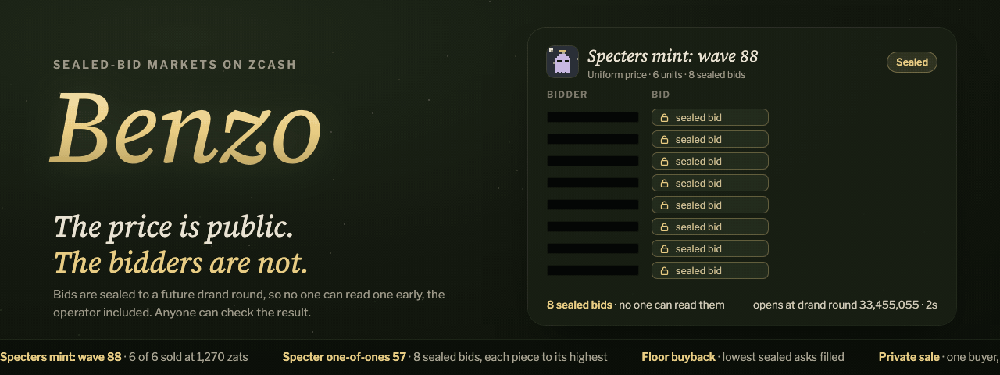
</picture>

<h3 align="center">Sealed-bid markets on Zcash.<br>Nobody reads a bid early. Not the other bidders, not the chain, not the operator.</h3>

<p align="center">
  <a href="https://benzo.space"></a>
  <a href="https://youtu.be/xqJnJRegB0k"></a>
</p>

<p align="center">
  
  
  
  
  
</p>

<p align="center">
  <a href="#try-it-in-a-minute">Try it</a> ·
  <a href="#why">Why</a> ·
  <a href="#how-it-works">How it works</a> ·
  <a href="#who-can-see-what">Who sees what</a> ·
  <a href="#check-it-yourself">Check it yourself</a> ·
  <a href="#the-markets">Markets</a> ·
  <a href="#screens">Screens</a> ·
  <a href="#run-it">Run it</a> ·
  <a href="#docs">Docs</a>
</p>

---

<a href="https://youtu.be/xqJnJRegB0k">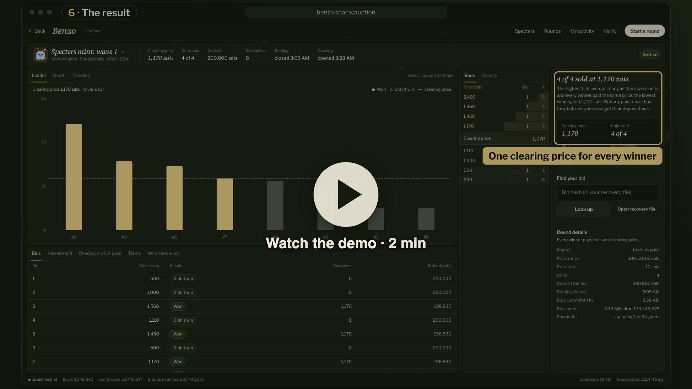</a>

## Try it in a minute

No wallet needed.

1. Open **[benzo.space](https://benzo.space)** and go to **Specters**.
2. Pick an open mint round and press **Bid now**.
3. Choose a price, press **Review bid**, then **Use the demo wallet**.
4. Save your recovery file when asked. Your browser seals the bid; the demo wallet pays the deposit.
5. Press **Track this deposit** and watch it get counted, frozen, opened and settled.
6. Open any settled round, go to **Verify**, and press **Try it** next to a cheat. The checks catch it.

Prefer the terminal? Clone the repo and run `npm ci && npm test`. It replays recorded rounds and the tampering they must refuse.

## Why

Every auction has the same weak spot: whoever runs it sees the bids first.

- On an exchange, the order book is a list of everyone's intentions.
- A "sealed" auction is sealed by a promise.
- On a public chain it's worse: every bid is a transaction anyone can read before the auction closes.

Take a DAO buying back its own token. If its bid is visible, sellers raise their asks. If the desk running it sees the asks, it trades ahead of them.

Benzo is a general engine for this: **any market where price discovery needs sealed orders**. Mints, buybacks, token launches, OTC blocks, procurement. Each one is a clearing rule on the same core, so that:

- **nobody can read a bid before a fixed moment**, the operator included;
- **the operator can't change which bids count** once that moment gets close;
- **nobody can pay out a wrong result**: two of three signers recompute it before signing, and anyone can recheck it after.

## How it works

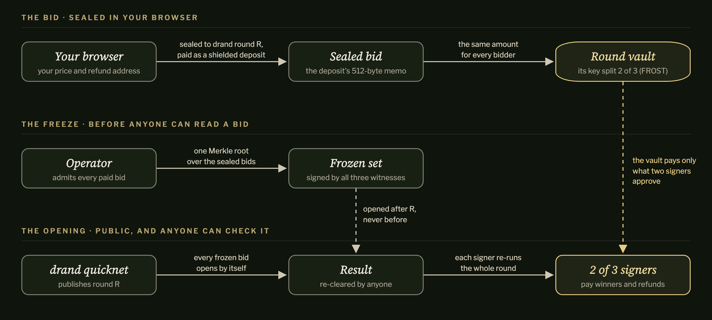

**1. Seal.** Your browser encrypts the bid to a future drand round `R` with timelock encryption. There is no key to steal: the key is drand's signature on `R`, and it doesn't exist until `R` is published.

<picture>
  <source media="(prefers-reduced-motion: reduce)" srcset="docs/assets/reel/seal.png">
  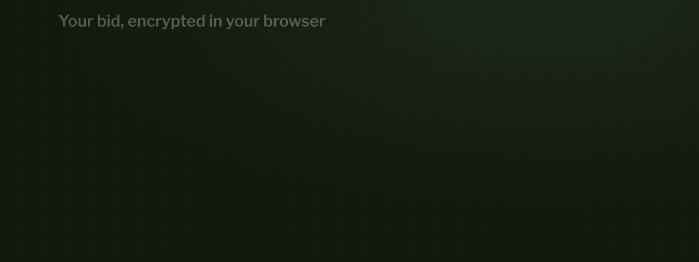
</picture>

**2. Pay.** The sealed bid rides in the memo of a shielded Zcash payment. Every bidder pays the same deposit, and every memo is exactly 512 bytes. Neither says anything about the price.

**3. Freeze.** Before `R`, the paid bids become one Merkle root, signed by three witnesses. The set is fixed while nobody can read it, so the operator can't pick whom to drop by price.

**4. Open, clear, settle.** At `R` every bid opens at once, for everyone. The market's rule is public, so anyone gets the same fills. Two of three FROST signers each re-run the whole round before they sign the payout.

<picture>
  <source media="(prefers-reduced-motion: reduce)" srcset="docs/assets/reel/open.png">
  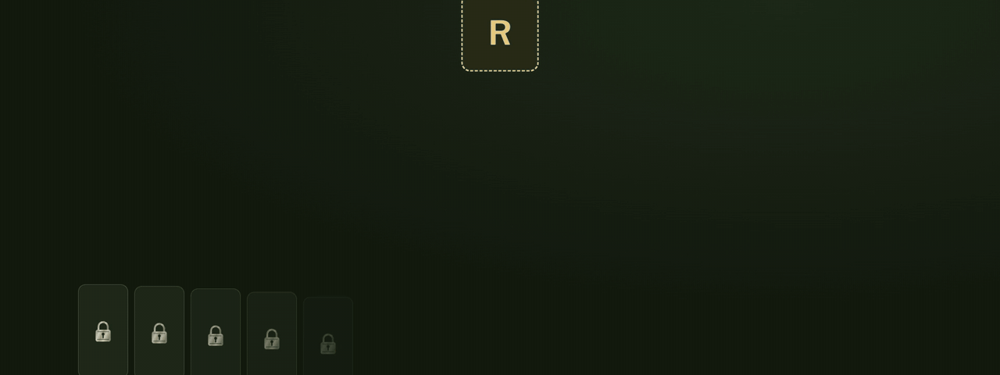
</picture>

The full walk-through, byte layouts and all, is in **[How Benzo works](docs/how-it-works.md)**.

## Who can see what

What each party is *able* to read, not what a screen chooses to show.

| | You | Other bidders | Operator | Each signer | Anyone |
|---|---|---|---|---|---|
| **Until the opening** | | | | | |
| Your price | Yes | No | No | No | No |
| That a sealed bid came in | Yes | Count only | Sealed copy | Sealed copy | Count only |
| Your refund address | Yes | No | No | Yes, to check payouts | No |
| **After the opening** | | | | | |
| Every bid's price | Yes | By bid number | By bid number | By bid number | By bid number |
| Who placed each bid | Your own | No | Network data* | Payout address | No |
| Where each payment went | Your own | No | No | Yes | Amounts only |

\* The site you bid through sees your network address and timing. Tor or a VPN hides them.

**What you trust:** a threshold of drand's League of Entropy nodes doesn't collude, and two of the three signers don't collude.
**What you don't have to trust:** the operator, the site, or this README.

## Check it yourself

Every round publishes its record: the signed terms, the frozen set, the witness statements, the openings, the result and the payment receipts. One file rebuilds the round from it.

```sh
npm ci && npm run build:verify
shasum -a 256 dist/benzo-verify.mjs     # must match docs/verify-bundle.sha256
node dist/benzo-verify.mjs \
  --signer "$(cat docs/evidence/verify-example/signer)" \
  --dir docs/evidence/verify-example/public
```

That's a recorded round: three sealed bids, opened at a drand round, paid by 2 of 3 signers. 19 checks, under a second, every one `OK`. The bundle rebuilds byte for byte from a fresh clone ([how](docs/reproducible-build.md)).

Every settled round on the site has a **Try to cheat** panel. It changes one thing in a copy of the record and runs the same checks:

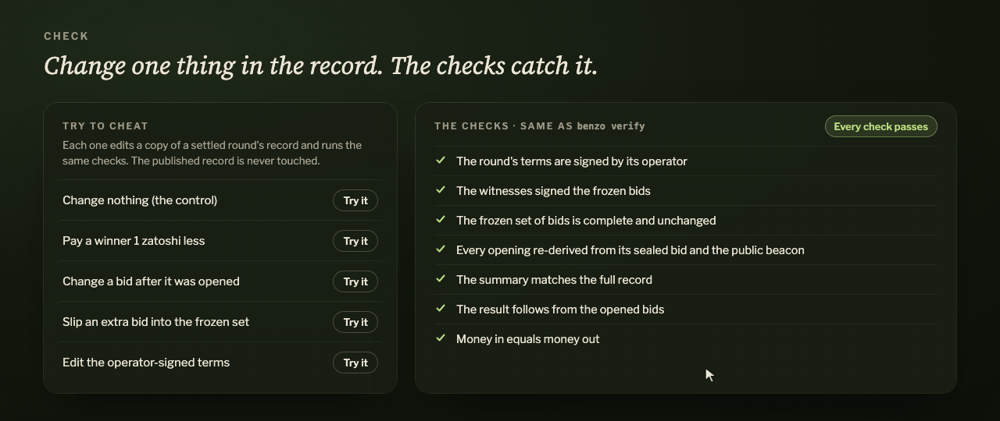

| The cheat | What the verifier says |
|---|---|
| Change nothing (the control) | 19 of 19 `OK` |
| Pay a winner 1 zatoshi less | `clear refused: canonical result differs`, `accounting refused` |
| Change a bid after it was opened | `opening 0 published differs from re-derived` |
| Slip an extra bid into the frozen set | `published opening count` |
| Edit the signed terms | `manifest byte hash` |
| Show the record under another operator's key | `signer mismatch` |

The control matters. If the untouched copy didn't pass, the refusals would prove nothing.

We also ran the one attack the root can't stop by itself: the operator dropped a paid bid before the freeze. The bidder's own page flagged it, and the signers refunded the deposit on the bidder's claim ([evidence](docs/evidence/left-out-bid/)).

## The markets

Sealing, deposits, freezing and payouts don't know which market they serve. A market is one entry in [`clear/registry.ts`](clear/registry.ts): an order layout, a clearing rule, a check on its result.

| Market | Who it's for |
|---|---|
| Uniform auction | many identical things at one fair price |
| Collection drop | numbered editions, without a race to mint |
| Token launch | a raise with no early-bird front-running |
| Buyback | a treasury buying back without showing its price |
| RFQ | procurement where quotes shouldn't leak to rival dealers |
| Blind OTC | a block trade where neither side shows its hand |

On the site they all sell one demo collection, **Specters**, the way a collection on Zcash really sells: a sealed mint at one clearing price, one-of-ones to the highest sealed bid, floor buybacks from sealed asks, private sales and commissions. Payouts can also land off Zcash: an ERC-5564 stealth address on Ethereum, or a confidential transfer on Solana ([logs](docs/evidence/crosschain/)).

## Screens

<table>
  <tr>
    <td width="50%">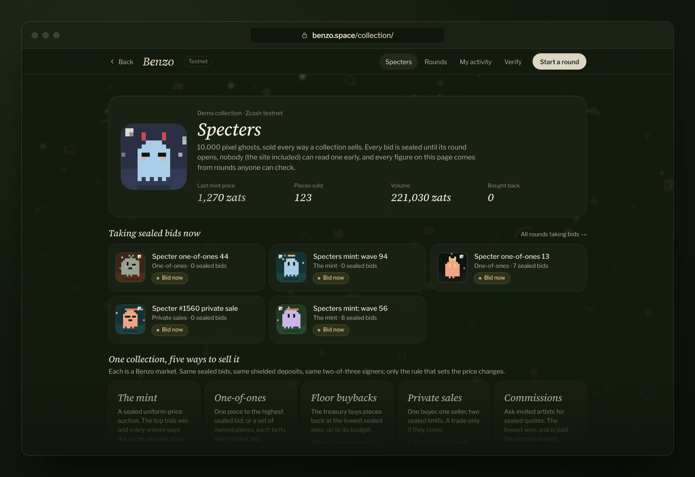<br><sub><b>The collection.</b> Floor, sales and volume, all from verifiable rounds.</sub></td>
    <td width="50%">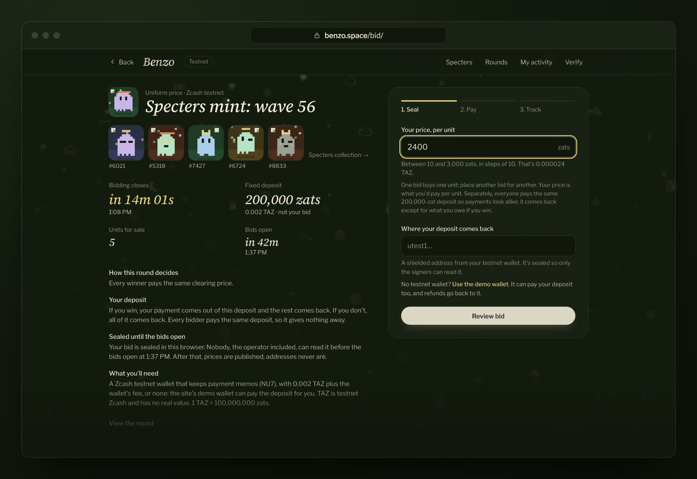<br><sub><b>Placing a bid.</b> Sealed in the browser before it leaves.</sub></td>
  </tr>
  <tr>
    <td>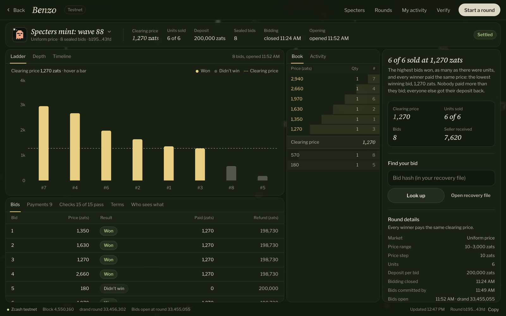<br><sub><b>The result.</b> Every price, by bid number. One clearing price.</sub></td>
    <td>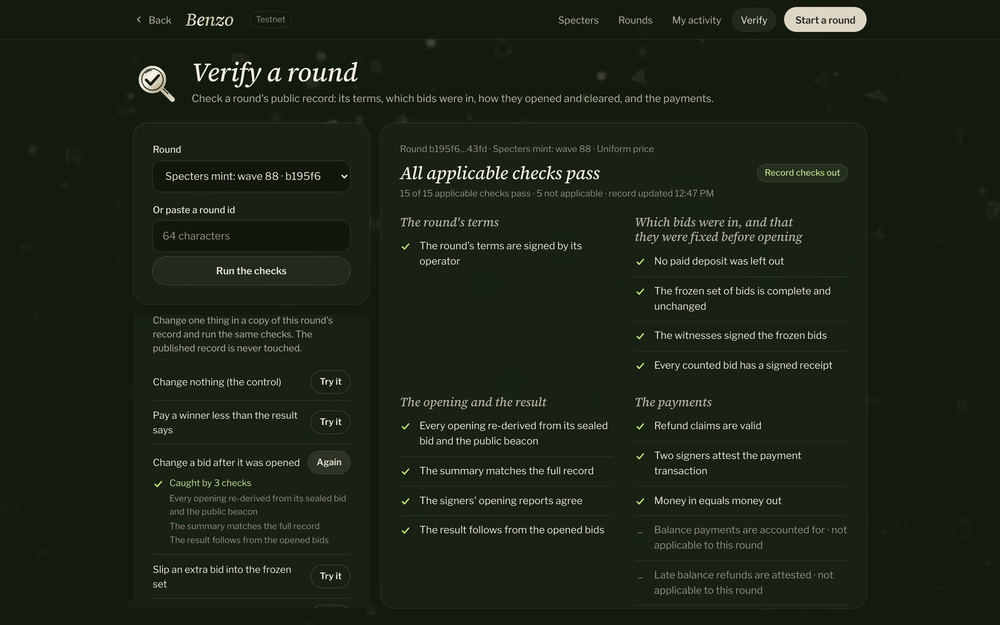<br><sub><b>Verify.</b> The same checks as the CLI, in the page.</sub></td>
  </tr>
  <tr>
    <td>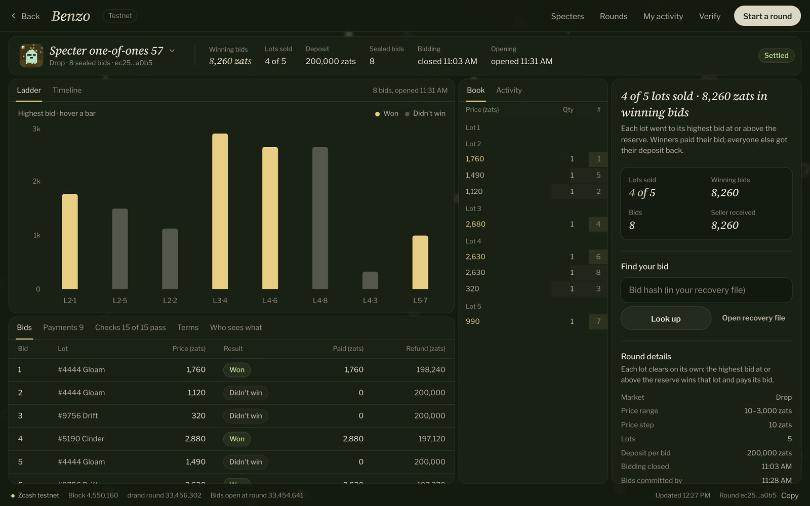<br><sub><b>A drop.</b> Numbered editions, no mint race.</sub></td>
    <td>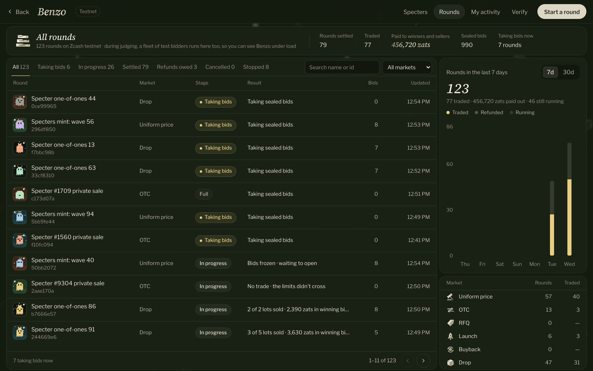<br><sub><b>Rounds.</b> Every market, every stage.</sub></td>
  </tr>
</table>

<p align="center">
  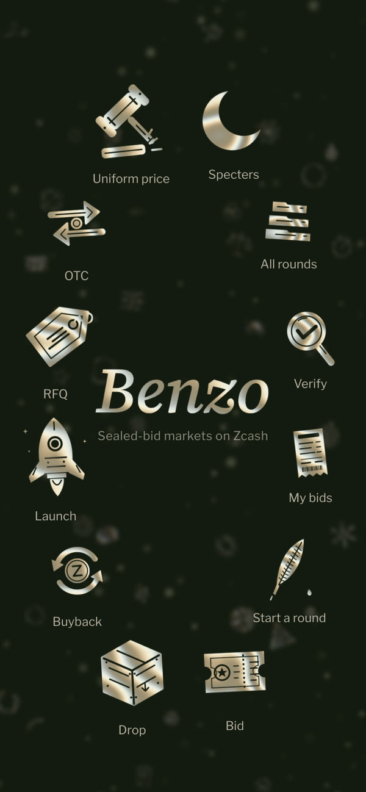&nbsp;
  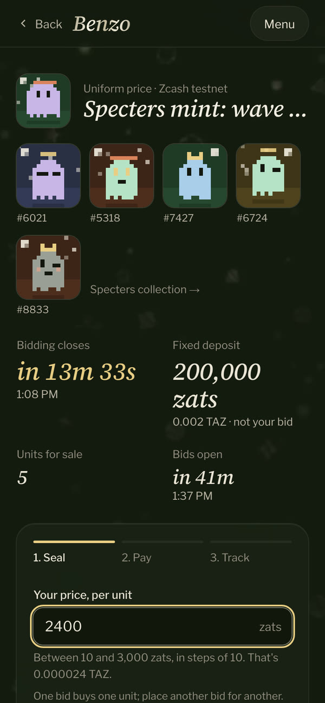&nbsp;
  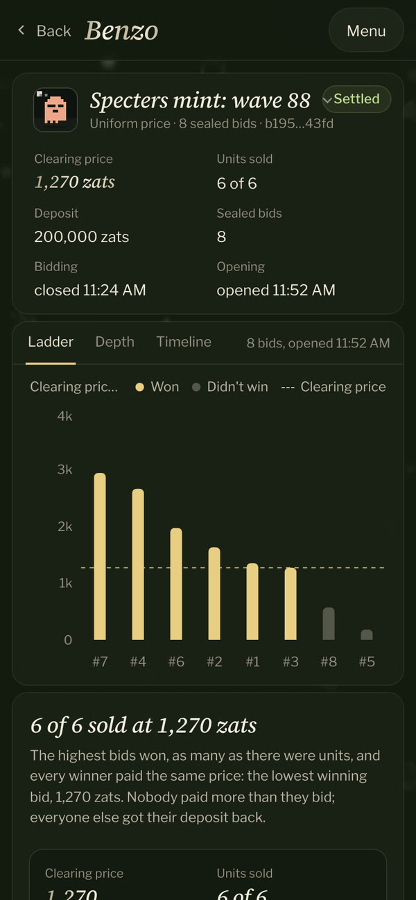
</p>

## What's been run

- **Every market through the live site**, by a browser test that starts a round, seals and pays bids, waits for the payout and runs the checks ([logs](docs/evidence/live-markets/)). Token launches run from the `benzo` CLI ([record](docs/evidence/launch-round/)).
- **A test fleet** of eight bidders, each with its own wallet, starting rounds and bidding through the public API with the bid page's own sealing code.
- **17,000 sealed bids** admitted, frozen, opened against real drand, cleared and verified in one round ([bench](docs/evidence/scale/bench.json)).

Every folder and what it proves: [`docs/evidence/`](docs/evidence/README.md).

## Run it

```sh
git clone https://github.com/akash-mondal/benzo && cd benzo
npm ci
npm test                                  # the verifier against recorded rounds, and the cheats it must catch
cd web && npm ci && npm run dev           # the site on localhost:4321
```

`npm run build:core && npm run build:cli` builds the engine and the `benzo` command. Running your own operator and signers is in the role guides below.

<details>
<summary><b>Repo layout</b></summary>

```
seal/        the browser sealer: tlock to a drand round, the 512-byte memo
envelope/    the 128-byte order, owner keys, refund envelopes
manifest/    the signed terms of a round
clear/       the Merkle freeze and the clearing rules, one entry per market
witness/     the witness statements over the frozen set
settle/      payment planning and the 2-of-3 FROST signing flow (Rust + TypeScript)
scan/        finds deposits on chain (Rust)
crosschain/  EVM and Solana payouts
cli/         the benzo command, including benzo verify
web/         benzo.space: the site and its API
docs/        how it works, guides, design, evidence
```

</details>

## Docs

| | |
|---|---|
| [How Benzo works](docs/how-it-works.md) | the round, layer by layer: sealing, the memo, deposits, the freeze, clearing, FROST payouts |
| [Verify it yourself](docs/verify-it-yourself.md) | check a round from its public record, step by step |
| [Why a timelock](docs/why-timelock.md) | why drand and not a key someone holds |
| [Guides](docs/guide-bidder.md) | [bidder](docs/guide-bidder.md), [operator](docs/guide-operator.md), [signer](docs/guide-signer.md) |
| [API reference](docs/api-reference.md) | every command and route |
| [Design](docs/research/DESIGN.md) · [Threat model](docs/research/threat-model.md) | the reasoning and the attacks it answers |
| [Dependencies and audits](docs/AUDITS.md) | which libraries carry the cryptography, and who audited them |
| [Reproducible build](docs/reproducible-build.md) | rebuild the verifier byte for byte |
| [Evidence](docs/evidence/README.md) | the recorded rounds and what each proves |

## Built with

[drand](https://drand.love) and [tlock](https://github.com/drand/tlock-js) · [FROST](https://github.com/ZcashFoundation/frost) · [librustzcash](https://github.com/zcash/librustzcash) · [@noble](https://paulmillr.com/noble/) curves and hashes · libsodium · Astro

MIT licensed. Built for Zecathon 2026.
