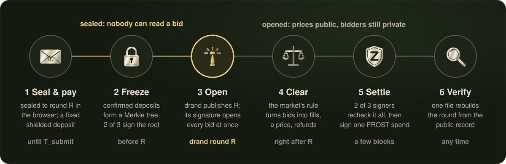
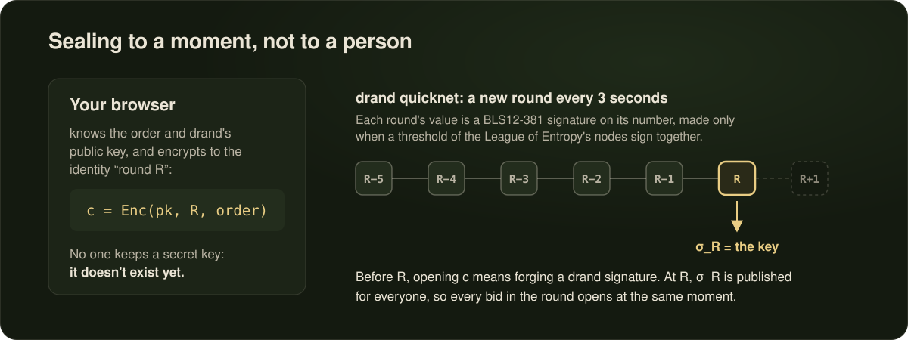
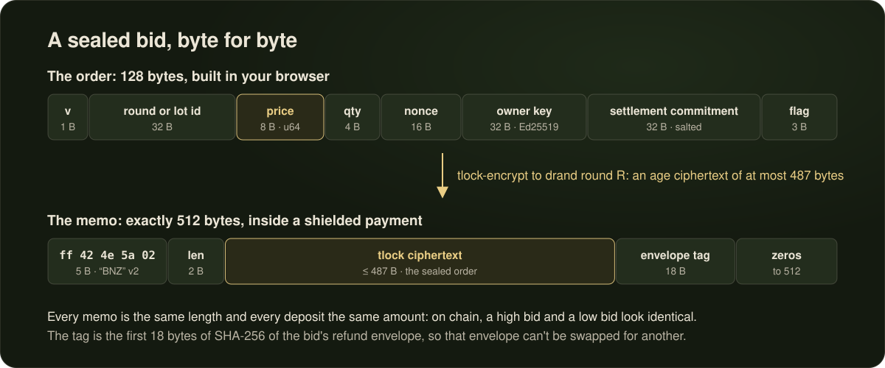
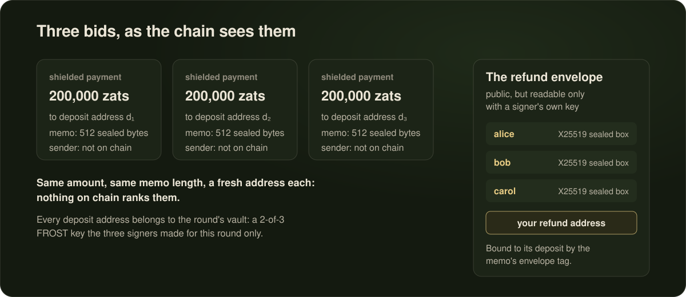
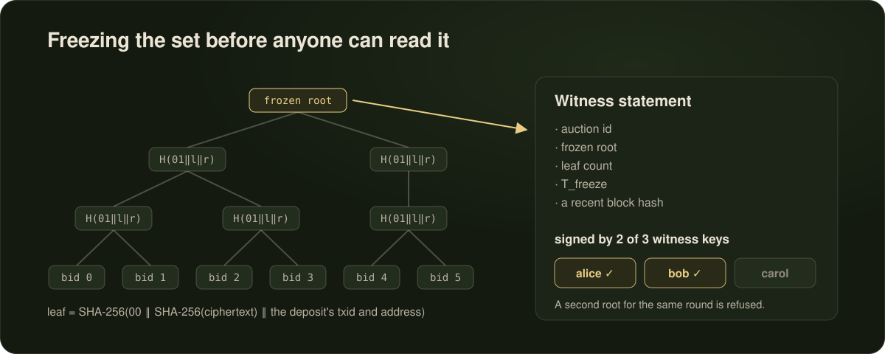
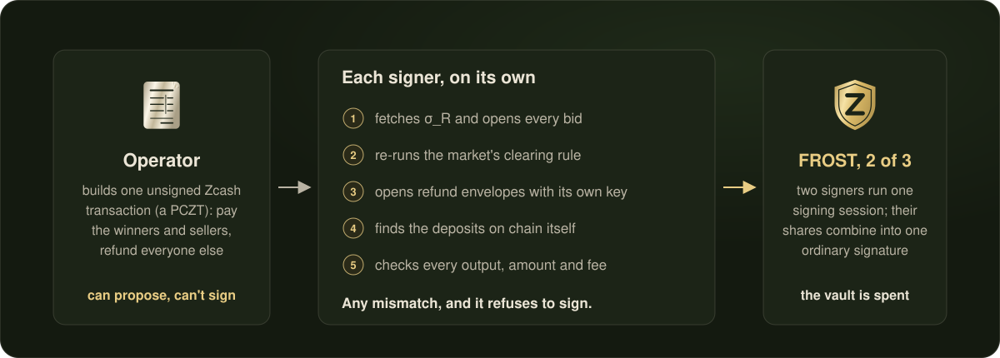

<p align="center"></p>

<p align="center"><a href="https://benzo.space"><b>Live demo →</b></a></p>

---

Every auction has the same weak spot: whoever runs it sees the bids first. On an exchange, the order book is a list of everyone's intentions, readable by whoever is closest to it. A "sealed" auction is only sealed by a promise. On a public chain it's worse: every bid is a transaction anyone can read, sorted by price, before the auction closes.

The Zecathon Private Markets track asked for the opposite: *the price should be public and the participants should not.*

Take a DAO buying back its own token. If its bid is visible, sellers raise their asks. If the desk running the buyback can see the asks, it can trade ahead of them. Benzo runs that buyback, or any sealed auction, so that:

- **nobody can read a bid before a fixed moment**: not the other bidders, not anyone watching the chain, not us, the operator;
- **the operator can't change the set of bids** once that moment approaches;
- **nobody can pay out a wrong result**, because two of three independent signers recompute it before signing, and anyone can recheck it afterwards.

After the opening, the prices are public and checkable; who bid stays private. Each of these rests on a stated assumption: drand's threshold of operators doesn't collude, and two of the three signers don't collude. This post walks through how it works, one layer at a time.

## A round, from first bid to proof

<p align="center"></p>

A round has a deadline for bids (`T_submit`), a moment the set of bids is locked (`T_freeze`), and an opening round `R` on the drand beacon. Everything before `R` is sealed. Everything after is public maths that anyone can redo. The rest of this post takes the steps in order.

## 1. Sealing to a moment, not to a person

The usual way to keep a bid secret is to encrypt it to someone's key. That just moves the trust: whoever holds the key can open it early. Benzo encrypts to a **time** instead, using [drand](https://drand.love) and timelock encryption (tlock).

<p align="center"></p>

drand's quicknet network publishes a value every 3 seconds. Each value is a BLS12-381 threshold signature on the round number, produced only when enough independent League of Entropy nodes sign together. tlock is identity-based encryption where the identity is a round number. The browser encrypts the order to "round R" using only drand's public key. The matching decryption key is drand's signature on R, which nobody has until R is published.

Two things follow:

- **There is no key to steal or leak before R.** Not on our server, not on a signer's, not anywhere. Opening a bid early means forging a drand signature, which takes a threshold of drand's operators colluding.
- **Every bid opens at once.** At R the signature is public, so the operator, the signers and every bidder can open every bid at the same instant. Nobody gets a head start.

The sealing runs in your browser ([`seal/src/main.ts`](seal/src/main.ts)). It makes no network request: drand's chain parameters are pinned in the bundle.

## 2. A sealed bid, byte for byte

<p align="center"></p>

The order is a fixed 128-byte record ([`envelope/bid.ts`](envelope/bid.ts)):

- **Price and quantity:** the only fields a market reads.
- **Round or lot id:** binds the order to one round or one lot, so it can't be replayed elsewhere.
- **A random nonce.**
- **A one-time Ed25519 owner key:** lets you prove later that a bid is yours without saying so now.
- **A salted commitment to where your refund goes.**

tlock turns those 128 bytes into an age ciphertext of at most 487 bytes. That ciphertext goes into a Zcash memo with a fixed frame: a 5-byte header (`ff` + `BNZ` + version 2), a 2-byte length, the ciphertext, an 18-byte envelope tag, and zero padding to exactly 512 bytes.

Fixed sizes are the point. Every bid in every round produces a memo of the same length. Nothing about its length says anything about its price.

## 3. Paying a deposit that says nothing

<p align="center"></p>

Each bid is a **shielded Zcash payment of a fixed deposit** (200,000 zats on the live site) to its own deposit address, with the sealed bid as the memo. Because the amount is the same for everyone, the deposit doesn't hint at the price. Because the payment is shielded, the chain doesn't show who sent it. Every deposit address belongs to the round's vault, a 2-of-3 key the three signers create for this round only (section 6).

Losers get the deposit back and winners pay out of it, so the system needs to know where to send money, without anyone learning it early. Your refund address goes into a **settlement envelope**, encrypted in your browser to the three signers' X25519 keys ([`envelope/index.ts`](envelope/index.ts)):

- **The body:** your address, padded to a fixed length and encrypted with ChaCha20-Poly1305 under a random content key.
- **The key:** wrapped once per signer with libsodium's sealed box.
- **A key commitment:** stops a sender from giving different signers different addresses.

The envelope is published, and only the three signers can open it: they need your address to check the refunds they sign. The memo's 18-byte envelope tag is a hash prefix of this envelope, so nobody can swap your envelope for theirs.

## 4. Freezing the set before anyone can read it

Sealing stops early reading, but an operator could still cheat on **which** bids count: drop one, or slip one in after peeking at others. Benzo closes that door before `R`.

<p align="center"></p>

A bid is admitted once its deposit has 10 confirmations and its memo checks out. At `T_freeze`, comfortably before `R`, the admitted bids become the leaves of a Merkle tree ([`clear/merkle.ts`](clear/merkle.ts)). Each leaf hashes the ciphertext and the deposit that paid for it. Two of three witnesses sign a statement naming the root, the leaf count, the freeze time and a recent block hash ([`witness/index.ts`](witness/index.ts)).

From that point the set is fixed, and it was fixed while every bid was still unreadable. A second statement for a different root is refused.

What the root can't prove on its own is that every valid bid made it in: an operator could refuse a funded bid before freezing. It can't do so quietly or profitably. Right after the freeze, still before `R`, each bidder can prove their bid is in the root (`benzo receipt prove`), and the site shows it as counted. A deposit that was paid in time but left out is owed back in full: its owner key claims it from the vault, and the verifier requires every deposit the operator listed to be either in the set or refunded. The operator also can't pick whom to drop by price, because when it freezes it can't read any price.

We ran that attack on the live site: the operator dropped a paid bid, the bidder's page caught it, and one click got the deposit back ([evidence](docs/evidence/phase-7/excluded-bid/)).

## 5. Opening and clearing: six markets, one engine

At `R` anyone can fetch drand's signature, open every frozen bid and apply the market's rule. The rule is public and deterministic, so everyone gets the same fills, the same price and the same refunds.

<p align="center"></p>

Sealing, deposits, freezing and settlement don't know which market they serve. A market is one entry in [`clear/registry.ts`](clear/registry.ts): an order layout, a clearing rule and a check on its result.

| Market | Who it's for |
|---|---|
| Uniform auction | selling several identical things at one fair price |
| Collection drop | numbered editions, without a race to mint |
| Token launch | a raise with no early-bird front-running |
| Buyback | a treasury buying back without telegraphing its price |
| RFQ | procurement where quotes shouldn't leak to rival dealers |
| Blind OTC | a block trade where neither side shows its hand |

Adding a market means writing a rule, not a new system.

## 6. Settling with a key nobody holds alone

The deposits sit in a vault whose spending key is split three ways with FROST, a threshold Schnorr scheme for Zcash. The three signers create it together with a dealerless DKG, once per round. No machine ever holds the whole key. Any two can spend; one can't.

<p align="center"></p>

The operator builds one unsigned Zcash transaction (a PCZT) that pays the winners and sellers and refunds everyone else. It can propose; it can't sign. Each signer then repeats the whole round on its own before it signs anything ([`settle/`](settle/)):

1. Fetch drand's signature and open every frozen bid.
2. Re-run the market's clearing rule.
3. Open each refund envelope with its own key.
4. Find the deposits on chain itself.
5. Check every output, amount and fee in the proposed transaction against what it computed.

If anything differs, it refuses. Two signers that agree run one FROST signing session, and the vault's notes are spent in an ordinary-looking shielded transaction. If a round has to be called off (say drand never publishes `R`), `benzo cancel` refunds every deposit in full, through the same signers, without opening a single bid.

## Check a round yourself

You don't have to trust the site, or this post. Each round publishes a public record: the signed terms, the frozen set, the witness statements, the openings, the result and the payment receipts. One file rebuilds the round from that record. With Node 24 and this repo:

```sh
npm ci && npm run build:verify
shasum -a 256 dist/benzo-verify.mjs     # must match docs/verify-bundle.sha256
node dist/benzo-verify.mjs \
  --signer "$(cat docs/evidence/phase-7/gold/doc-walk/signer)" \
  --dir docs/evidence/phase-7/gold/doc-walk/public
```

That folder is a real testnet round: three sealed bids, opened at a drand round and settled by 2 of 3 signers. The verifier runs 19 checks in under a second, and every one prints `OK`:

- **Terms and the frozen set:** the operator's signature on the terms; every leaf against the frozen root; the witness statements.
- **The opening and the result:** every opening against drand's published signature; the result re-cleared from scratch with the market's rule.
- **The money:** the accounting (money in equals payouts plus refunds plus fees); every receipt against the result.

The bundle rebuilds byte for byte from a fresh clone ([`docs/reproducible-build.md`](docs/reproducible-build.md)).

The Verify page of every settled round on the site has a **Try to cheat** panel. It copies the public record, changes one thing, and runs the same checks. Against the round above:

| The cheat | What the verifier says |
|---|---|
| Change nothing (the control) | 19 of 19 `OK` |
| Pay a winner 1 zatoshi less than the result says | `clear refused: canonical result differs` and `accounting refused` |
| Change a bid after it was opened | `opening 0 published differs from re-derived` |
| Slip an extra bid into the frozen set | `published opening count` |
| Edit the operator-signed terms | `manifest byte hash` |
| Show the record under another operator's key | `signer mismatch` |

The control matters: if the untouched copy didn't pass, the refusals would prove nothing.

## Who can see what

This is what each party is able to read, not what a screen chooses to show. Each round's page on the site has the same table.

| | You | Other bidders | Operator | Each signer | Anyone |
|---|---|---|---|---|---|
| **Until the opening** | | | | | |
| Your price | Yes | No | No | No | No |
| That a sealed bid came in | Yes | Count only | Sealed copy | Sealed copy | Count only |
| Your refund address | Yes | No | No | Yes, to check payouts | No |
| **After the opening** | | | | | |
| Every bid's price | Yes | By bid number | By bid number | By bid number | By bid number |
| Who placed each bid | Your own | No | Network data* | Payout address | No |
| Where each payment went | Your own | No | No | Yes | Amounts only |

\* The site you bid through sees your network address and timing. Use Tor or a VPN to hide them.

## Try it without a wallet

Open any round on [benzo.space](https://benzo.space), pick a price and press **Use the demo wallet**. Your browser still seals the bid. The site's demo wallet pays the deposit from the payment link alone, so it never learns your price; it does know which deposit it paid for. Refunds go back to the demo wallet. With your own testnet wallet, pay from it instead: the page shows a QR code and a payment link.

## What's running

- **[benzo.space](https://benzo.space)**, on Zcash testnet:
  - **The whole product:** start a round in any market, invite bidders, seal, pay, watch the opening, settle and check.
  - **The test fleet:** during judging, eight test bidders ([`deploy/fleet/lite-bot.ts`](deploy/fleet/lite-bot.ts)) run alongside it. They start rounds and bid through the site's public API with the bid page's own sealing code, so you can see Benzo under load. Each has its own wallet, and every bid is a real sealed deposit.
- **Every market, driven through the live site** by a browser test that starts a round, seals and pays bids, waits for settlement and runs the round's checks ([logs](docs/evidence/phase-7/ui-drive/)):
  - Uniform, drop, OTC and RFQ: settled, every check passes, and the browser test passes.
  - Buyback: settled with 11 payments, every check passes, and the browser test passes.
  - Launch: a launch's winners record where their units go with the CLI (`benzo launch deliver`), which the site doesn't collect yet, so launch rounds aren't started on the site. The full launch flow, delivery list included, passes through the CLI on testnet ([log](docs/evidence/phase-5/markets/launch-a18/launch-meet.out)).
- **Cross-chain payouts:**
  - Ethereum Sepolia: a payout to a one-time ERC-5564 stealth address ([log](docs/evidence/phase-5/repro/stealth-live.out)).
  - Solana devnet: a Token-2022 confidential transfer ([log](docs/evidence/phase-5/repro/ct-live.out)).
- **Scale, offline:** 17,000 sealed bids admitted, frozen, opened against real drand, cleared, planned for payment and verified ([`bench.json`](docs/evidence/phase-6/bench.json)). The deposits there are synthetic, not 17,000 on-chain payments; paying that round out would take about 608 transactions. A live round takes about an hour from start to settlement, so Benzo is built for scheduled auctions, not continuous trading.

The rest of the evidence, and what each folder proves, is indexed in [`docs/evidence/phase-7/README.md`](docs/evidence/phase-7/README.md).

## Run it yourself

```sh
git clone https://github.com/akash-mondal/benzo-zcash && cd benzo-zcash
npm ci && npm run build:core && npm run build:cli     # the engine and the benzo command
cd web && npm ci && npm run dev                        # the site, on localhost:4321
```

A full deployment (operator, three signers, frostd) is one Docker image: [`deploy/render/`](deploy/render/). Guides for each role: [bidder](docs/guide-bidder.md), [operator](docs/guide-operator.md), [signer](docs/guide-signer.md). Every API route: [`docs/api-reference.md`](docs/api-reference.md).

```
seal/        the browser sealer: tlock to a drand round, the 512-byte memo
envelope/    the 128-byte order, owner keys, refund envelopes
manifest/    the signed terms of a round
clear/       the Merkle freeze and the clearing rules, one entry per market
witness/     the witness statements over the frozen set
settle/      payment planning and the 2-of-3 FROST signing flow (Rust + TypeScript)
scan/        finds deposits on chain (Rust)
crosschain/  EVM and Solana payouts
cli/         the benzo command, including benzo verify
web/         benzo.space: the site and its gateway
deploy/      the Docker image, the the host deploy and the test fleet
docs/        guides, design, threat model, evidence
```

Further reading: the [design](docs/research/DESIGN.md), the [threat model](docs/research/threat-model.md) and [why a timelock](docs/why-timelock.md).

MIT licensed. Built for Zecathon 2026.
