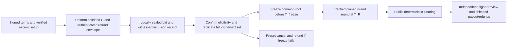

# Sealed-bid Zcash auction threat model

Research snapshot: 2026-09-30. Scope: shielded ZEC deposits + drand tlock bids + FROST-controlled escrow + public recomputation + FROST-signed payouts/refunds; optional NEAR Intents funding. These are architecture findings, not an audit of a completed auction implementation. **All ratings, priorities, mitigations and residual-risk assessments are design judgments.** The `evidence.facts` and source references in each JSONL row contain the factual basis; `evidence.design_inference` explains the transfer to this design.

## Decision (design judgment)

The proposed architecture can credibly seal **honest bidders’ bid values until the pinned release round**, including against the auction operator, only if collateral and every visible field are independent of the bid and the drand signing threshold remains uncompromised. It cannot honestly promise unconditional “nobody can read” or “no leaks”: bidders know their own inputs, compromised clients can exfiltrate them, metadata remains, and the chosen public recomputation publishes bid values after close.

**Do not ship bid-sized escrow deposits.** A receiving viewing key decrypts the note value as well as the outer memo. A tlock-encrypted memo does not conceal a deposit equal to the bid. Use one auction-wide fixed collateral ticket `C`, a fixed quantity cap `q_max` and price cap `B_max`, with `C >= q_max * B_max`; fund fees/bond at an additional fixed amount or from an operator reserve. Varying deposit tiers and numbers of tickets leak bounds/demand. Random overcollateralization still leaks an upper bound. Public evidence and detailed derivation: threats 001, 016 and 018.

FROST is **threshold custody**. A spend-authorizing quorum can steal and a blocking coalition can freeze funds; public recomputation does not create on-chain auction enforcement. Timelock release is **public disclosure**, not permanent losing-bid privacy. Keep refund/delivery identities outside the publicly decryptable plaintext (011, 014, 017).

## Assets, adversaries and assumptions

Protect bid price/quantity before release; bidder-to-bid identity and refund/delivery linkage; escrow principal and fee reserves; complete timely acceptance; deterministic clearing; and eventual correct payout/refund. Treat the operator, ingress/storage hosts, scanners, RPC/indexers and bidders as potentially malicious. Include seller-controlled shills, mining/censorship adversaries, drand members, custody signers, frontend/supply-chain attackers, analytics providers, cross-chain services and a network observer. Coalitions can combine otherwise weak metadata.

Distinct thresholds must be named: `t_d` beacon members can release future-round keys; `t_s` of `n_s` custody signers can spend; `n_s-t_s+1` refusing/offline signers can block. A separate board-witness threshold authenticates admission/time/completeness under its own honesty assumption. For independently signed root certificates with up to `f_w` corrupt out of `n_w` witnesses, require `2*q_w > n_w+f_w` and `q_w <= n_w-f_w`, plus durable one-root-per-auction signing and authenticated checkpoint exchange (066). A custody threshold cannot simply be reused as a safe witness configuration. These are not interchangeable. Independent keys on one operator-controlled machine/cloud account are not independent parties.

Assume reviewed cryptographic primitives and secure honest bidder devices; fewer than `t_d` corrupt beacon members; fewer than `t_s` corrupt custody signers; enough available signers who enforce the policy; an honest-enough witness configuration with a common pre-release checkpoint; and a stated probabilistic chain-confirmation/reorg policy. No number of confirmations guarantees deterministic PoW finality. Global traffic analysis, external identity knowledge and settlement-role collusion remain residual risks. The supplied no-contract/no-custom-shielded-asset and upgrade context is an input assumption, not independently established deployment evidence.

## Data visibility (architectural facts and conditional deductions)

| Observer | Before release | After release / settlement |
|---|---|---|
| Public chain observer | Transaction times, shape, fees/pool boundaries and public legs; fully shielded individual note values are hidden | Same metadata; public board exposes chosen bid transcript |
| Escrow receipt key holder | Deposit values, receipt addresses, outer memos and timing; inner tlock bid stays sealed under its assumptions | Bid values plus mappings already in its possession |
| Bid board / ingress | Ciphertexts, size, one-time ticket/key and submission/network metadata | All published bid plaintexts |
| drand signing threshold | Can generate the future-round signature early | Public beacon release supplies decryption material |
| Custody quorum / authorized transaction roles | Only fields actually supplied, potentially note/value/FVK/prover material; FROST does not hide packages | Can authorize spends; builders/signers may see refund addresses and amounts |
| RPC/indexer / network observer | Query selectors, scan ranges, broadcasts and traffic; no plaintext decryption from transport observation alone | Can correlate payout requests/timing and external legs |
| NEAR funding service / source-chain observer | Quote fields / public source sender, amount and timing respectively | Service can retain endpoint mappings; the inspected bridge policy can also make a shielded withdrawal publicly recoverable (061) |

These are observer-specific disclosures, not proof that every current wallet logs all listed fields. See code inspections and each threat’s conditions.

## Minimum design for judging “no leaks” (recommendation)

1. **Seal at the client.** Encrypt locally using the pinned mainnet unchained beacon/round and reviewed randomized implementation. No plaintext POST, server-side encryption, telemetry, log, error report or cloud prover sees bids. Independently validate exact header/network/round/recipient count; use reproducible, pinned frontend assets.
2. **Make collateral independent.** Exactly one uniform `C` per ticket, fixed quantity/price limits and separate fixed fee policy. No bid-dependent deposit, top-up, transaction count, public validation tag or quote amount. Escrow IVK compromise must still reveal only `C`, not the bid. Cap total funded exposure.
3. **Freeze before release.** Signed terms specify `T_submit < T_freeze < T_R`, confirmation threshold, chain anchor policy, witnessed full ciphertext root and reorg rules. All eligibility checks and accepted-set decisions finish before `T_freeze`. If freeze cannot complete, cancel/refund; never extend admission or reopen the same sealed auction after plaintext becomes available.
4. **Bind and replicate every accepted bid.** Unique funded ticket, fresh owner key, external authorization signature and encrypted auction/manifest/owner binding. One note/ticket supports one final liability. Complete ciphertexts live on independent mirrors before acceptance; clients get inclusion receipts and independent witnesses reconcile completeness. Witness/eligibility trust must be disclosed; public math alone proves neither.
5. **Keep identities out of the public opening.** Only anonymized price/quantity and one-time authorization fields enter tlock plaintext. Put shielded refund/delivery targets in a separate authenticated permanently encrypted settlement envelope; salt its public commitment. Bind the envelope digest to the owner signature before accepting funds and preserve the invalid-bid refund path. No public bidder wallet FVK, refund UA, quote ID or delivery identity. Disable bid revisions for MVP; old/cancelled tlock ciphertexts remain openable (065).
6. **Keep all auction money shielded.** Enforce intended shielded receiver/pool, reject transparent fallback, fresh refund receivers and local key generation. Use fee/shape policies independent of bid value, and scheduled shielded refunds. Do not publish unredacted PCZT, note witnesses, outgoing recovery keys or address mappings.
7. **Cover RPC and transport metadata.** Use a verified wallet transport policy, anonymity routing that fails closed, normalized scan windows and memo retrieval cover independent of recognition, separate scan/broadcast sessions, no analytics and restricted logs. RPC cover/Tor each addresses a different leak. If the chosen wallet cannot provide these, explicitly narrow the identity-privacy claim and do not present it as satisfying strict “no leaks.”
8. **Use real independent custody and transaction review.** Dealerless authenticated DKG, separate shares/backups, durable single-use signing nonces and audited RedPallas/PCZT compatibility. Every signer recomputes results and checks recipients/values/fees/change against the immutable root and liability ledger. Demonstrate quorum settlement and a coordinator outage; disclose collusion/blocking thresholds.
9. **Make clearing/accounting reproducible.** Commit integer arithmetic, reserve, supply, tick, tie, invalid-bid, rounding and fee rules in advance. Independent verifiers agree; durable settlement states handle unknown broadcasts/reorgs without double paying. Public result auditability and public payment execution evidence are separate claims.
10. **Keep optional cross-chain funding outside the strict privacy path.** Default demo uses pre-existing shielded ZEC. Cross-chain mode funds a bidder-controlled wallet first, then makes an independent fixed shielded deposit after a buffer; no quote/bridge identifier appears in bid transcripts. Direct bid-sized bridge-to-escrow funding is disallowed. Ordinary 1Click exposes quote fields to its service and transparent source legs to observers; fresh addresses and shielding do not erase that history. Check outgoing recovery-key policy: the inspected bridge path uses a public zero OVK even for shielded withdrawals (061).

This set is an expected acceptance bar, not a proof of zero leakage. If strict judging requires hiding participation/IP against a global observer, eliminating authorized-quorum custody or hiding losing bids forever, this architecture does not meet that requirement. Stop/re-scope that claim instead of adding a disclaimer to a leaky implementation.

## Intended lifecycle (recommendation)

`T_submit` ends submissions; `T_freeze` is the latest allowed finalization; `T_R` is the fixed public opening round. Choose the confirmation buffer from the actual network/integration, and cancel if it is insufficient. Never use block timestamps or a browser countdown as proof of witnessed pre-release acceptance. Frozen-root certificates, funded-ticket attestation and payout attestations are separate objects with separate trust boundaries.

## Directly inspected facts that drive the design

- Receipt viewing keys expose memo and note value, so a sealed memo cannot hide bid-sized collateral. [librustzcash `decrypt.rs:92–115`](https://github.com/zcash/librustzcash/blob/f7b1cfb0b5bb1bdb10564079ac51b54aa18b07a1/zcash_client_backend/src/decrypt.rs#L92-L115).
- The unchained beacon signs a round digest; its timing is independent of Zcash finality. [drand `schemes.go:216–249`](https://github.com/drand/drand/blob/2363f3b9ba5fd6f14e0b84a096b248479790d75d/crypto/schemes.go#L216-L249), [tlock paper](https://eprint.iacr.org/2023/189).
- Signing nonces must be single-use; the library cannot make database retries or backup restoration safe on its own. [FROST `round1.rs:207–256`](https://github.com/ZcashFoundation/frost/blob/0966bd1529aa062ad3b621af99e277f976b1c0f0/frost-core/src/round1.rs#L207-L256).
- PCZT freezes transaction effects but does not select economically correct payouts. [PCZT `io_finalizer/mod.rs:71–79`](https://github.com/zcash/librustzcash/blob/f7b1cfb0b5bb1bdb10564079ac51b54aa18b07a1/pczt/src/roles/io_finalizer/mod.rs#L71-L79).
- The inspected bridge uses an all-zero OVK to recover the recipient and amount of its payout. This specific code policy is publicly recoverable even though the output is shielded. It is not evidence that every live 1Click route uses this path. [NEAR bridge `orchard_policy.rs:11–75`](https://github.com/Near-One/btc-bridge/blob/7740fae0ed8dc56571adfe2aaf36bd4edee0d441/contracts/satoshi-bridge/src/zcash_utils/orchard_policy.rs#L11-L75).
- Uniform-price multiunit demand reduction and shilling are mechanism/economic concerns separate from encryption. [Ausubel et al., 2014](https://users.ssc.wisc.edu/~mweretka/Drafts/ACPRW2014_June_p.pdf), [Shill-Proof Auctions](https://economics.princeton.edu/wp-content/uploads/2025/07/2404.00475v2-Roughgarden.pdf). Neither paper establishes a universal current-implementation exploit.

## Ranked threat register (design judgments)

Rank prioritizes direct privacy/custody failure and irreversible fairness failure, then likelihood and implementation urgency. `P0` is a launch blocker or mandatory explicit trust boundary; `P1` is required hardening/operating policy; `P2` is economic/strategic behavior or residual risk to document. Likelihood is qualitative for the **unmitigated stated architecture**, not a measured probability. “Certain if …” is a conditional design consequence. Low-likelihood critical risks remain P0.

| Rank | ID | Priority | Threat | Likelihood | Impact | First mitigation |
|---:|---|---|---|---|---|---|
| 1 | 001 | P0 | Bid-sized deposits defeat operator blindness | Certain if deposit = bid | Critical | One auction-wide collateral C for every ticket; no bid-dependent top-ups, change sent to escrow, or public tiers. |
| 2 | 021 | P0 | Client plaintext exfiltration, debug logs or server-side encryption | High in an ordinary web app | Critical | Encrypt on a trusted local client before any network request; no server encryption/prover receives plaintext bids. |
| 3 | 003 | P0 | Wrong beacon, past round or alternate recipient bypasses the seal | Medium | Critical | Client and admission validators independently compare the exact release round, pinned beacon key/hash/scheme/genesis/period and auction manifest hash. |
| 4 | 004 | P0 | Wall-clock release occurs before the chain cutoff is final | High if height alone closes bidding | Critical | Publish deposit/admission deadline T_submit, fixed confirmation policy k, freeze deadline T_freeze and exact release time T_R with T_submit < T_freeze < T_R. |
| 5 | 006 | P0 | Bid-set equivocation or post-close insertion | Medium | Critical | Use content-addressed full ciphertexts, append-only checkpoints and an immutable signed final root before T_R. |
| 6 | 066 | P0 | Unsafe witness quorum permits two valid frozen roots | Medium for naive reuse of custody threshold | Critical | Specify board witness n_w, tolerated corrupt f_w and certificate q_w separately from custody t_s; enforce one root per auction/epoch persistently. |
| 7 | 017 | P0 | Published tlock plaintext exposes refund address or bidder identity | Certain if identity is in public payload | Critical | Publicly decryptable bid contains only price, quantity, auction terms binding, one-time owner key/ticket and opaque independently salted refund commitment. |
| 8 | 026 | P0 | Unified-address negotiation silently falls back to transparent payment | Medium | Critical | Validate intended network and explicit supported shielded receiver/pool; refuse transparent-only addresses and wallet-selected transparent fallback for auction money. |
| 9 | 037 | P0 | NEAR quote service maps funding to auction/refund identity | Certain for submitted ordinary quote fields | High | Keep NEAR optional and separate from the strict privacy demo; default to shielded ZEC already held by the bidder. |
| 10 | 038 | P0 | Transparent source leg or bridge-to-escrow reveals bidder and cap | High for direct public funding | High | Disallow direct bid-sized source transfer/quote to escrow; use independent fixed funding and bidder-controlled shielding before auction deposit. |
| 11 | 061 | P0 | A shielded bridge payout deliberately has public recovery data | Certain on the inspected policy path | Critical | Inspect actual bridge output encryption/OVK policy, not only whether the recipient is a UA or output is in Ironwood. |
| 12 | 002 | P0 | drand threshold collusion releases bids early | Low / conditional | Critical | Pin an established mainnet unchained beacon, public key, scheme, chain hash, genesis and period in signed auction terms; do not use an operator-owned/test beacon. |
| 13 | 011 | P0 | FROST quorum colludes to steal or redirect deposits | Conditional | Critical | Use genuinely independent signers with separate devices, operators and credentials; disclose t_s-of-n_s and who controls each share. |
| 14 | 012 | P0 | Signing nonce reuse after retry, crash or backup rollback | Medium in ad hoc integration | Critical | Persist nonce allocation/consumption atomically before exposing commitments; burn nonces on abort, timeout and unknown outcome. |
| 15 | 013 | P0 | Dealer, DKG transport or backup quietly centralizes custody | Medium | Critical | Use authenticated dealerless DKG with consistent participant lists/public commitments; verify common group key and deposit addresses on independent devices. |
| 16 | 015 | P0 | Signer rubber-stamps a coordinator-supplied digest or mutable PCZT | Medium | Critical | Independently derive the payout/refund plan from canonical result and liability ledger; compare every recipient, amount, memo policy, fee, change, network/pool and transaction version. |
| 17 | 018 | P0 | Fake funded bids or hidden liabilities pass public recomputation | Medium | Critical | One independently scanned confirmed note funds at most one domain-bound ticket; signers reconcile note uniqueness, reserve and total outstanding liabilities. |
| 18 | 062 | P0 | A txid or public result is misrepresented as proof of correct payouts | Medium | Critical | Provide each bidder a private domain-bound settlement receipt and expected output details for their wallet to verify, including confirmation state. |
| 19 | 052 | P0 | Spend shares, refund-envelope keys or long-lived secrets compromised | Medium | Critical | Use per-auction/epoch least-privilege keys, independent hardened signer hosts and encrypted offline backups; separate spend/share/view/refund/identity secrets. |
| 20 | 049 | P0 | Spoofed auction manifest, address, round or signer identity | Medium | Critical | Sign a canonical auction manifest binding escrow receiver/pool/network, group key/epoch, beacon config, deadlines, caps, fees, reserve, supply and dispute/refund policies. |
| 21 | 057 | P0 | Pool/upgrade/signature mismatch breaks actual shielded execution | Medium for new integration | Critical | Pin tested network/pool/transaction versions and compatible zcash_client_backend, PCZT and RedPallas rerandomized signing/proving code. |
| 22 | 005 | P0 | Coordinator censors or selectively drops funded bids | High for a sole ingress | High | Replicate encrypted bids and signed acceptance receipts across independent witnesses; publish inclusion proofs and checkpoints before release. |
| 23 | 007 | P0 | Ciphertext withholding becomes a reveal-griefing option | High if only hashes are replicated | High | Acceptance requires complete bounded ciphertext bytes already available to independent mirrors, not just a URI/hash. |
| 24 | 009 | P0 | Ciphertext copying, replay or deposit reassignment | Medium | Critical | Bind a fresh bidder authorization key, unique ticket ID, escrow epoch, auction ID, manifest hash and ciphertext digest with an external owner signature checked before freeze. |
| 25 | 010 | P0 | Small-domain plaintext commitment or deterministic encryption | Medium | Critical | Use reviewed randomized hybrid tlock encryption with OS CSPRNG; no deterministic price encryption or bid hash without a secret salt. |
| 26 | 008 | P0 | Malformed ciphertext or deliberately invalid hidden bid | High | High | Validate exact bounded outer schema and recipient count before admission; sandbox expensive parsing and enforce per-ticket resource limits. |
| 27 | 019 | P0 | Public recomputation diverges on auction arithmetic | Medium | High | Commit exact mechanism, reserve/supply, price tick, integer zatoshi units, bounds, fee rules, rounding, invalid-bid policy and deterministic tie/allocation rule before bidding. |
| 28 | 020 | P0 | Settlement retries pay twice or omit a refund | Medium | Critical | Use a durable liability ledger keyed by auction/ticket/result/batch; distinguish planned, signed, broadcast, mined and confirmed states. |
| 29 | 014 | P0 | Quorum unavailable or selectively refuses payout after seeing results | Medium | High | Prearrange n_s,t_s with enough independently available policy-honest signers; exercise alternate coordinators and full refund signing before accepting funds. |
| 30 | 016 | P0 | Escrow viewing-key disclosure widens the observer set | High if keys are widely shared | High | Use a dedicated auction/escrow epoch account; never request bidder wallet viewing keys or share an escrow FVK publicly. |
| 31 | 036 | P0 | Memo overflow, pointer fetch or truncation silently breaks confidentiality | Medium | High | Measure exact chosen tlock framing plus all ticket/signature/refund fields against the actual binary memo budget; binary arbitrary Memo convention may leave 511 payload bytes. |
| 32 | 067 | P0 | Refund-envelope substitution or discretionary lost-key recovery | Medium | Critical | Before acceptance register a bounded private refund envelope authenticated by the same ticket owner; external signed binding covers its digest and independently salted public commitment. |
| 33 | 050 | P0 | Seller changes supply/reserve or refuses to deliver after clearing | Medium | High | Precommit asset identity, quantity, reserve, delivery criteria and cancellation/dispute rules in signed terms; prevent changes after first accepted bid. |
| 34 | 042 | P0 | Front-running a reveal or the public opening | High if mutable admission persists | Critical | Finalize immutable accepted set before any release; reject all post-freeze price/quantity/refund ownership changes. |
| 35 | 022 | P1 | Wallet storage, browser persistence and backups reveal inputs or keys | Medium | Critical | Use device-protected encryption and explicit retention for local bid drafts; do not persist plaintext bids or wallet secrets in browser localStorage or shared demos. |
| 36 | 023 | P1 | Delegated prover receives witness or bid-related secrets | Medium if outsourced | High | Define the exact prover input contract; never include a hidden bid in a standard Zcash transaction witness or hosted proof request. |
| 37 | 024 | P1 | Unredacted PCZT or FROST coordination leaks addresses and account scope | High if packages are broadly shared | High | Use role-specific minimum packages; redact FVKs, recipients/values/derivation metadata when the receiving role does not need them. |
| 38 | 025 | P1 | Refund address reuse and cross-auction key reuse link bidders | High if reused | High | Generate a fresh shielded refund receiver and one-time owner key per ticket/auction, outside public tlock plaintext. |
| 39 | 027 | P1 | Transparent funding, unshielding or migration correlates amounts and time | High with immediate public legs | High | Default to pre-existing shielded ZEC; avoid immediate public funding-to-bid and refund-to-unshield round trips. |
| 40 | 028 | P1 | Ticket counts, collateral tiers and top-ups reveal quantity or budget | High for linked tickets | High | Use a fixed quantity cap per indistinguishable ticket and a single collateral class; no quantity-dependent top-up or note count. |
| 41 | 029 | P1 | Recognized-transaction and memo retrieval reveals wallet interests | High if selective fetch used | High | Perform trial decryption locally from normalized compact-block ranges; never upload bidder viewing keys. |
| 42 | 030 | P1 | Exact scan checkpoints and server watermark link rotated sessions | Medium | High | Normalize scan starts to common windows with intentional overlap, decouple foreground auction use from synchronization and avoid exact birthday disclosure. |
| 43 | 031 | P1 | Malicious or stale indexer supplies false eligibility/confirmation state | Medium | High | Scan/verify chain data with a trusted local full-node path where feasible and independent endpoint cross-checks; bind confirmation state to exact block hash/height. |
| 44 | 032 | P1 | Transaction broadcast reveals bidder IP or device session | High without private transport | High | Broadcast through reviewed anonymity transport with fail-closed routing and separate scan/auction sessions; no direct clearnet fallback. |
| 45 | 033 | P1 | Global traffic timing and intersection defeat transport anonymity | Conditional / medium | High | Use buffered windows, scheduled submission/refund batches and fixed request/payload profiles; avoid a click-to-immediate-deposit-to-quote sequence. |
| 46 | 034 | P1 | Analytics, authenticated accounts and UI labels deanonymize tickets | High if common web defaults used | High | Anonymous participation UI without login/analytics/advertising pixels; isolate auction origin and avoid third-party wallet telemetry. |
| 47 | 035 | P1 | Transaction shape, memo chunks and ciphertext length reveal bid class | Medium | High | One fixed-size bid schema and padding independent of price/quantity; fixed chunk/action policy if multiple outputs are necessary. |
| 48 | 039 | P1 | Cross-chain delay, slippage or refund race misses the auction cutoff | High near close | High | Stop cross-chain funding well before T_submit with route-specific confirmations and a conservative buffer; quote expiry is not auction eligibility. |
| 49 | 040 | P1 | Published prices, full bid transcript and repeated auctions leak valuations | Certain for public bid recomputation | High | Explicitly promise pre-close value secrecy; obtain clear disclosure that bid values are public after release. |
| 50 | 041 | P1 | Commit-reveal fallback restores bidder non-reveal griefing | High if manual reveal required | High | Use fully available tlock ciphertext with all semantic fields sealed; no bidder-controlled second reveal step. |
| 51 | 043 | P1 | Last-block sniping, fee priority and miner censorship | High near a hard cutoff | High | Separate conservative T_submit from T_freeze/T_R; show confirmation requirements and pending-versus-accepted status honestly. |
| 52 | 044 | P1 | Seller-controlled shill bids manipulate second/uniform price | High if seller can bid anonymously | High | Commit seller identity/policy, reserve/supply and cancellation rules; disallow known related bidders and require every bid be fully funded and irrevocable under preset terms. |
| 53 | 045 | P1 | Sybil flooding overwhelms admission, storage and refund processing | High | High | Admission is limited by confirmed fixed collateral plus a preset per-ticket processing bond/fee and bounded ciphertext size; do not rely on IP limits as Sybil resistance. |
| 54 | 048 | P1 | Tie-break grinding or randomness influenced by accepted-set choice | Medium | High | Commit an explicit tie rule before bidding; never use attacker-grindable lowest owner-key/hash, arrival order or coordinator-supplied random seed without analysis. |
| 55 | 051 | P1 | drand outage, delayed signature or unsafe fallback key release | Medium | High | Fetch verified signatures from multiple independent relays and use cached chain config; reject invalid signatures, not merely endpoint errors. |
| 56 | 053 | P1 | Dust, tagged amounts or unsolicited notes poison privacy/accounting | Medium / wallet-dependent | High | Accept only domain-bound confirmed C deposits under explicit registration; unsolicited notes do not create tickets or alter pool liability accounting. |
| 57 | 054 | P1 | Validation/error oracle exposes hidden bid bounds | Medium | High | Pre-close acceptance checks only public outer binding, uniform funding, resource bounds and fixed header fields; no plaintext-dependent threshold results. |
| 58 | 055 | P1 | Refund fees, batch size and note fragmentation exhaust reserves | Medium / high at scale | High | Publish fixed fee/bond treatment, funded operator fee reserve, total ticket cap and batch limits; reserve enough for invalid/late/cancelled deposits too. |
| 59 | 056 | P1 | Ingress/storage denial of service or concentrated infrastructure | High for one host | High | Use independently operated submission/mirror endpoints, bounded per-ticket resource policies and verified complete snapshots. |
| 60 | 058 | P1 | Cancellation or emergency refund becomes a post-open option | Medium | High | Commit objective cancellation triggers and deadlines before bidding; unresolved freeze failure cancels before T_R with no same-auction reopening. |
| 61 | 059 | P1 | Cross-auction state, key or note reuse confuses liabilities | Medium | Critical | Use unique immutable auction IDs/manifests and escrow epochs, dedicated ledger namespaces and reserved note/liability mappings. |
| 62 | 060 | P1 | Refund/price arithmetic reveals bid or quantity to authorized settlement roles | Certain for roles seeing the payout plan | High | Keep C independent of bid; losing refunds equal the same C minus the same preset fees/bond, without bid-dependent differential. |
| 63 | 063 | P1 | Secret-dependent encryption/proving/scanning timing leaks values or receipt identity | Conditional / low on reviewed current code | High | Use current reviewed constant-time cryptography and fixed-length bid encoding; no price-dependent branches or iteration in exposed pre-close paths. |
| 64 | 064 | P1 | Malicious wallet/prover embeds a covert tag in public randomness | Low / conditional | High | Use trusted reproducible wallet/prover/client builds, reviewed randomness generation and no opaque hosted transformation of ciphertexts. |
| 65 | 065 | P1 | Amended, withdrawn or cancelled tlock bids are still permanently openable | Certain if old ciphertexts retained | High | Simplest MVP permits one immutable bid per funded ticket; replacement/update semantics are disabled. |
| 66 | 068 | P1 | Winner delivery, public NFT transfer or entitlement reveal links bidder identity | High if delivery is public/identified | High | Keep delivery identity/address in the authenticated permanent settlement/delivery envelope, not the public bid/results payload. |
| 67 | 046 | P2 | Bid shading and multiunit demand reduction | High for strategic markets | Medium | Choose and clearly name the mechanism; do not promise truthful bidding for a multiunit uniform-price format. |
| 68 | 047 | P2 | Bidder collusion, bid rotation or external bribes | Medium / market-dependent | High | Keep terms/results auditable and admission independent of seller discretion; require funded bids and limit observable pre-close demand signals. |

## Implementation gates and acceptance evidence

The register has **68 threats**. Highest-priority gates are fixed collateral, client-side encryption, authenticated beacon/round, pre-release freeze, private refund/delivery envelopes, independent custody, and actual shielded deposit/refund execution. Also resolve exact memo byte budget (036), funded-ticket public verification boundary (018), witness quorum/clock policy (066), complete private settlement evidence (062), and asset delivery (050/068). These are concrete design decisions and checks, not claims that the integration already works.

For the judge demo, show: an adversarial escrow viewer reading only uniform C and ciphertext; attempted early decryption without the round key; tampering/copy/late-entry rejection; coordinator failure with mirror-based opening; matching independent result hashes; signer refusal of a changed refund recipient; and independently verified shielded payout/refund receipts. Separately document that a malicious beacon threshold can release early and a custody quorum can steal or block. Never claim these trust boundaries have been cryptographically eliminated.

## Scope

This model was written before the build, from public documentation and the code of earlier auction systems. It
lists what the design has to defend against; the rest of the docs say how each part is handled.
